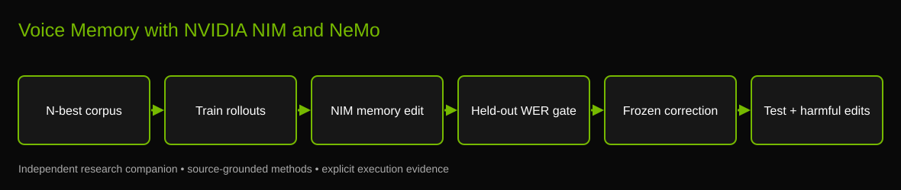

# Voice Memory with NVIDIA NIM and NeMo

Optimize a short, editable text memory while keeping the speech-correction model frozen. A candidate edit is accepted only when selection-set word error rate strictly improves. The test set is evaluated after optimization.



## Paper and public project links

- [Voice Memory paper](https://arxiv.org/abs/2607.26410)
- [Upstream method, code and memory artifacts](https://huggingface.co/huckiyang/voice-memory)
- [HyPoradise corpus](https://huggingface.co/datasets/PeacefulData/HyPoradise-v0)
- [NeMo Speech](https://github.com/NVIDIA-NeMo/Speech)

## Three reusable examples

Developer vocabulary, meeting instructions, and financial terminology. The bundled nine utterances are independently authored teaching data, not HyPoradise recordings.

## Method and scope

The implementation follows rollout → reflect → bounded add/delete/replace → strict held-out acceptance → deployment with one corrector call. It uses a NIM corrector and a WER gate. Upstream also reports semantic-gated experiments with different correctors. No upstream non-commercial code or memory files are redistributed. The HF resource is code and text memories, not downloadable model weights.

The LoRA path is a separate weight-adaptation baseline and is not the original frozen-model Voice Memory method. The included English normalization is not a multilingual tokenizer. Reference text is never included in correction prompts. NeMo Speech audio transcription is an optional 1-best input path; it is not claimed to reconstruct the original Whisper 5-best oracle.

## Quickstart

```bash
python -m venv .venv
# Linux/Colab: source .venv/bin/activate
# Windows: .venv\Scripts\Activate.ps1
pip install -e .
python -m unittest discover -s tests -v
python -m project_demo prepare --mode fixture
python -m project_demo demo --mode fixture
```

Install `pip install -e ".[cpu,tutorial]"` for real dataset/audio/image handling and interactive widgets. NVIDIA GPU environments have their own dependency lock; do not replace their torch with the CPU wheel.

## Real model execution

Configure `NVIDIA_API_KEY` / `HF_TOKEN` through environment variables or Colab Secrets. Never paste them into saved cells. For NIM, use an endpoint your account can access. Each live run records attempted calls and errors; no fallback generates fake results.

```bash
# Replace DATA with the preparation directory containing train/selection/test.jsonl
python -m project_demo evaluate --mode live --data-dir DATA
```

## HF and NeMo AutoModel LoRA


GPU environment: use NVIDIA's `nvcr.io/nvidia/nemo-automodel:26.10.00` container, then install this repo editable. The direct loader/LoRA APIs are source-checked against AutoModel commit `c57935fc64faea913ce9f5e38ea7e57e6416cc93`. If a container's package predates these APIs, install that exact source revision in an isolated environment, record the installed revision, and rerun validation. Never upgrade the user's unrelated environment.

The training loop performs actual gradient updates, saves adapter tensors, clears and reloads them, verifies exact reload equality, and generates before/after held-out outputs. Failure of any step is a failed run, not a passed import check. Start on one H100 for the small teaching models. Record actual peak memory before increasing the sample size.


```bash
python -m project_demo train --mode live --data-dir DATA --steps 20
```

## Colab tutorials

- [Interactive quickstart](https://colab.research.google.com/github/virginiakm1988/voice-memory-nvidia/blob/main/notebooks/01_quickstart.ipynb)
- [Evaluation and error analysis](https://colab.research.google.com/github/virginiakm1988/voice-memory-nvidia/blob/main/notebooks/02_evaluation.ipynb)
- [NeMo AutoModel LoRA](https://colab.research.google.com/github/virginiakm1988/voice-memory-nvidia/blob/main/notebooks/03_automodel_lora.ipynb)

`fixture` is always the default teaching mode. Change the single mode dropdown to run real models. GPU cells show their environment requirement explicitly. Larger checkpoints and licensed resources require their stated access and hardware.

## Evidence and review

Every command creates a unique run directory with `execution.json`, exact configuration, package versions, raw predictions, metrics, timing and failures. Reusing an output root never overwrites a previous run. Public evidence is collected in `evidence/`; large datasets and checkpoints remain in ignored storage. See `docs/PLAYBOOK.md` and `docs/REVIEW.md`.

## License

Independently authored code is Apache-2.0. Data, pretrained models and any attributed third-party code keep their own licenses. Download tools do not grant access to gated artifacts. Read `THIRD_PARTY_NOTICES.md` before redistributing.

### Measured results (2026-11-16)

- **NIM / real HyPoradise ATIS:** 3 training, 3 selection and 3 official test utterances. The loader excluded 39 overlapping original training records before splitting. Both proposed memory edits were rejected: selection WER rose from 0.05 to 0.35 and 0.65. Final test WER stayed **0.08108**; no improvement is claimed.
- **NeMo AutoModel:** the separate ungated Qwen2.5-0.5B-Instruct teaching baseline completed 4 actual updates, adapter save/clear/reload, and before/after generation on the same 3 official test utterances. This weight-adaptation baseline is distinct from the frozen NIM corrector. Exact match was 0 before and after. Output WER fell from 5.51351 to 0.10811, largely because the small baseline initially generated verbose text instead of only a transcript. This is a tiny teaching comparison, not a paper result or a like-for-like comparison with the larger NIM model.
- **NeMo Speech 3.0:** Parakeet transcribed a new authored synthetic WAV in the actual GPU run. This verifies the acoustic 1-best input route, not the original paper's N-best oracle generation.
- Gated Llama access and earlier environment failures remain in evidence; no model substitution is hidden.

To prepare real corpus inputs, run `python -m project_demo prepare --mode live` and pass its printed run directory as `--data-dir` to the NIM or LoRA command. The small original corpus records used in the measured run are retained with source revision and attribution in `evidence/20261116T091303-prepare-60f77848/`.

For acoustic input, install `nemo_toolkit[asr]==3.0.0` in a separate speech environment, then run `python -m project_demo transcribe --mode live --audio assets/authored-example.wav`. The authored example is a pedagogical TTS recording and is not participant data.

### Validated environment and compatibility

The actual Taipei-1 runs used NeMo AutoModel 0.7.0, torch 2.15.0+cu132 and transformers 5.18.0 on one H100. Exact package locks and failed/successful execution manifests are retained in `evidence/`. Use `PYTHONNOUSERSITE=1` to prevent unrelated user packages from shadowing the isolated runtime.

For AutoModel 0.7.0 with the tested Triton release, run `python scripts/patch_automodel_0_7_triton.py` inside the dedicated environment. This applies the exact upstream one-line autotune-key correction, backs up the original file, and prints source hashes. The text teaching path uses AutoModel's documented `force_hf=True` loader option with NVIDIA's LoRA patcher. Parakeet acoustic transcription runs in a separate NeMo Speech 3.0 environment; its resolved checkpoint revision was `541d1f99c6b0c3cd0b11a95167540bb8edefd82b`.

### Rescore and audit

`python -m project_demo evaluate --results PATH_TO_PASSED_RUN` recomputes saved predictions without model calls. It retains source mode/configuration and source-manifest SHA-256 and rejects failed runs. Without `--results`, evaluate explicitly runs the configured fixture/live workflow.

See [independent two-round review](REVIEW.md). Nine notebooks across these three projects were executed with fixture defaults and show separately recorded live SDK evidence; GPU training is an explicit opt-in checkbox. Small-sample training is reported honestly whether scores improve, stay flat or worsen.
